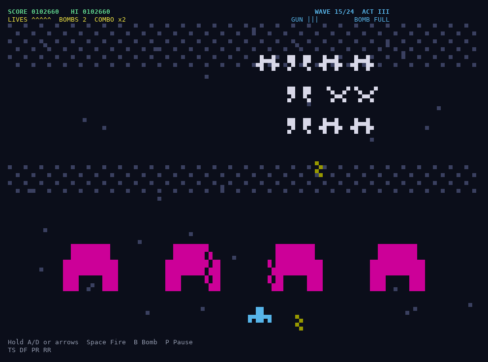
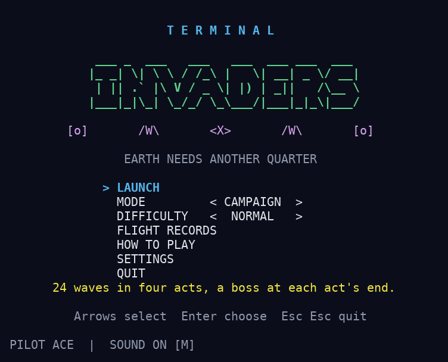
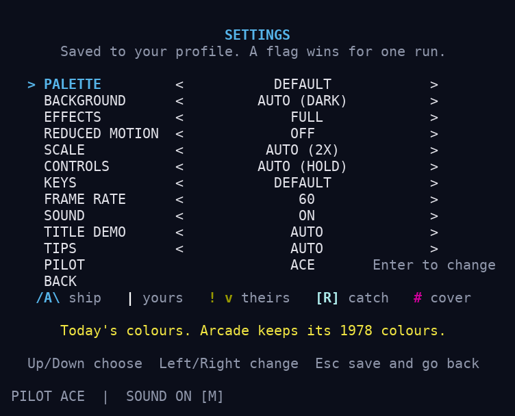
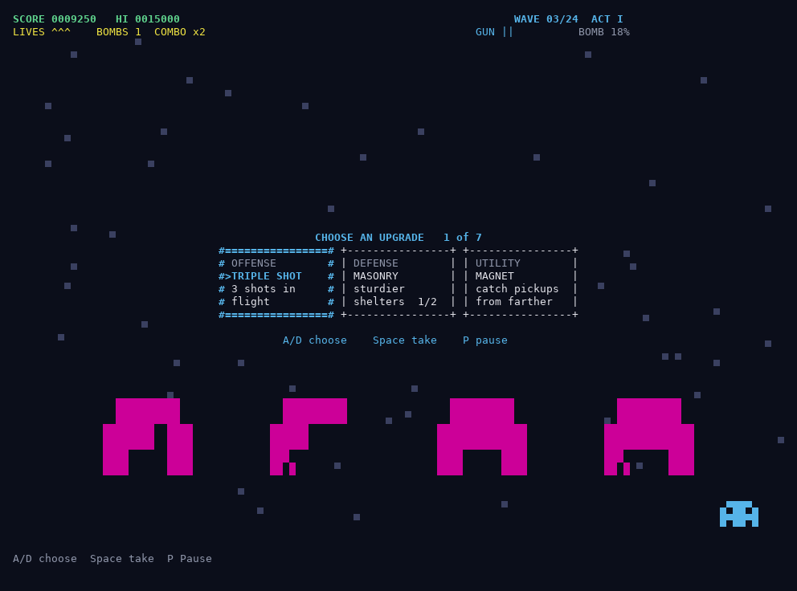
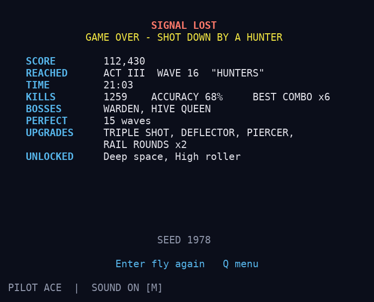
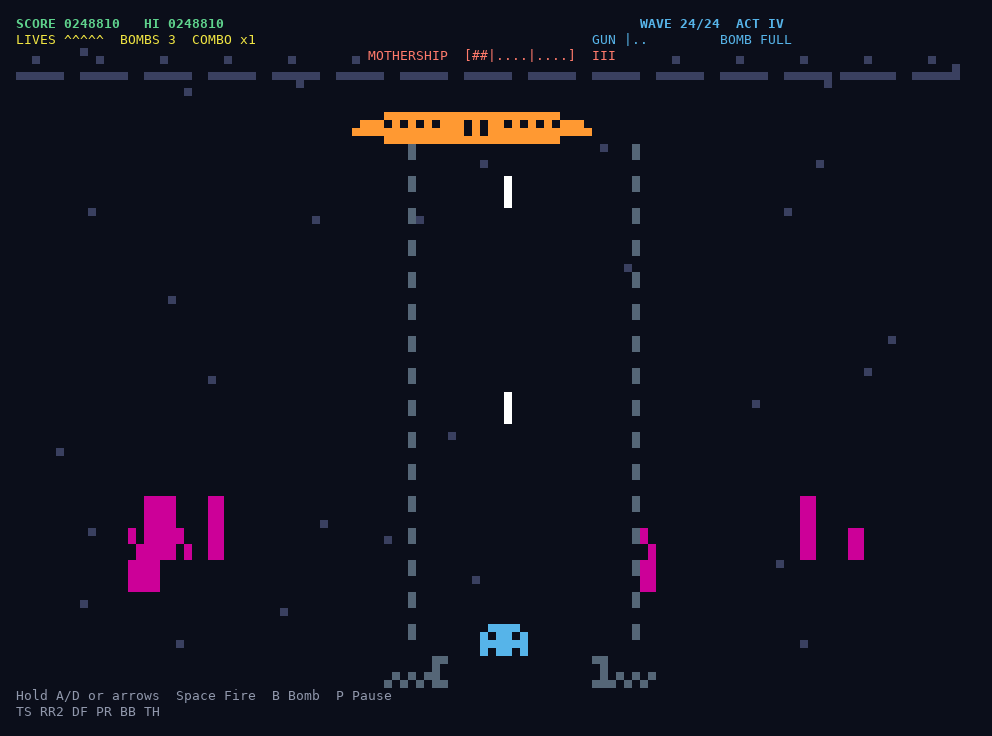
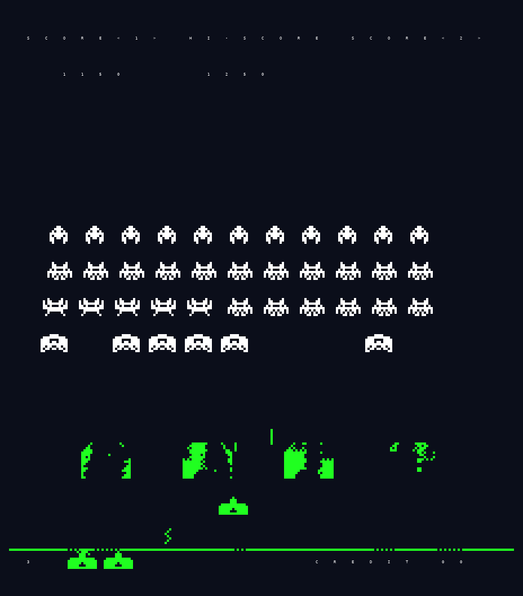
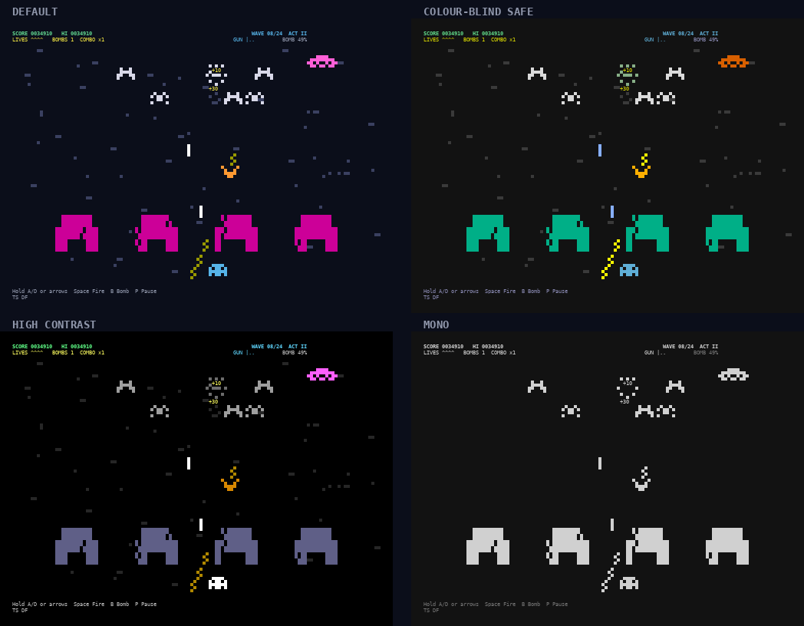

# Terminal Invaders

[](https://github.com/tbassignana/terminal_invaders/actions/workflows/ci.yml)

Space Invaders, rebuilt for the terminal: a 24-wave campaign with bosses and upgrades, the 1978 arcade game ported rule for rule, and pixel-art graphics that grow with your window. It runs on macOS and Linux and needs nothing but Python.



## Play

You need macOS or Linux and Python 3.11 or newer.

1. Open a terminal. On a Mac, that's Terminal, in Applications > Utilities.
2. Type `python3 --version` and press Enter. If it shows 3.11 or higher, go on to step 3. If it shows 3.9, or a window offers to install developer tools, install Python from [python.org](https://www.python.org/downloads/), then close Terminal and open a new window. With Homebrew, `brew install python@3.13` works too: then type `python3.13` wherever this page says `python3`.
3. Get the game and start it:

   ```sh
   git clone https://github.com/tbassignana/terminal_invaders.git
   cd terminal_invaders
   python3 invaders.py
   ```

   Without git, click the green **Code** button at the top of this page, then **Download ZIP**, and open the ZIP in your Downloads folder to unzip it. Then run `cd ~/Downloads/terminal_invaders-main` and `python3 invaders.py`.

The window needs to be at least 60 columns wide and 24 rows tall, and 32 rows for Arcade mode. The bigger it is, the bigger the game: the pictures on this page are a 120 x 44 window, which a full-screen window usually is. On the title screen, the arrow keys pick a mode and a difficulty, Enter starts, and HOW TO PLAY shows the keys.

To get a shorter `invaders` command, install the game in the project folder:

```sh
./setup.sh
source .venv/bin/activate
invaders
```

If you installed Python with Homebrew, run `PYTHON=python3.13 ./setup.sh` instead of `./setup.sh`. The `invaders` command works in a terminal window where you've run `source .venv/bin/activate` in the game's folder, so in a new window run that line again first. Everywhere else on this page, `python3 invaders.py` in the project folder does the same as `invaders`.

## Controls

| Key | What it does |
| --- | --- |
| Left and right arrows (or A / D) | Move |
| Space (or Up) | Fire. Hold it to keep firing (in Arcade mode, one shot per press) |
| Down (or S) | Stop |
| B | Bomb |
| P or Esc | Pause. R restarts, Q goes back to the menu |
| M | Sound on or off |
| Esc on the title menu, then Esc again or Enter | Quit |

In kitty, Ghostty, recent iTerm2 and Alacritty, and a few others, the ship moves while you hold a direction and stops when you let go (not inside tmux, screen or mosh). In Terminal.app and most other terminals, tap a direction and the ship keeps moving until you tap the other way or press Down. The [guide](docs/GUIDE.md#controls) has every key, the other key layouts, and how each terminal behaves.

## What's in the game

- **Campaign**: 24 waves in four acts. Each act ends with a boss that changes its attack as you break it apart. Pick an upgrade every three waves, chain hits for combo points, and keep your bomb for emergencies. Play it on Easy, Normal or Hard; a winning run takes about half an hour.
- **Endless** keeps going after the campaign with a new twist every wave. The **Daily challenge** is the same game for everyone that day. **Two players** can take turns.
- **Arcade** plays by the 1978 cabinet's own rules, ported from its program routine by routine: the same fleet, shots, saucer and scoring.
- **Effects**: hits burst into sparks, stars drift past and scores pop up. **Big windows** (120 x 44 and up) get a bigger arena drawn as pixel art, with flying debris too.
- **Accessibility**: colour-blind safe, high contrast and mono palettes, reduced motion, and effects kept to a safe flash rate.
- **Sound**, local high scores with your initials, replays, and tips during your first run.

## Screenshots

| | |
| --- | --- |
|  |  |
| The title screen | Settings, saved for next time |
|  |  |
| Choosing an upgrade between waves | The results, with what ended the run in words |
|  |  |
| The last boss | Arcade mode, by the 1978 rules |



## Settings

SETTINGS on the title menu picks the palette, background, effects, reduced motion, arena size, controls, keys, frame rate, sound, title demo, tips and your initials, and saves them for next time. `invaders --help` lists the command-line options. The [guide](docs/GUIDE.md) explains each of them, the modes, and the Campaign's acts, bosses and difficulties.

## If something goes wrong

- **The window is too small**: make it bigger or the font smaller. The game says the size it needs.
- **No sound**: in the game's folder, `python3 -m terminal_invaders.audio.check` plays every sound once and prints a report. Its last line includes `"pass": true` when sound works.
- **Colours or keys look wrong**: `invaders --probe` shows what the game found out about your terminal. Please include the output of `invaders --probe --raw` when you [report a problem](https://github.com/tbassignana/terminal_invaders/issues).
- **The terminal is left in a strange state** after the game was killed: type `reset` and press Enter.

## Under the hood

The game is pure Python with no dependencies. It drives the terminal itself with ANSI escape sequences rather than curses: it asks the terminal what it supports, reads key releases through the kitty keyboard protocol, draws each frame as one synchronized update, and over SSH it paces frames by the terminal's own replies, so your keys don't wait behind frames the link hasn't delivered yet. Terminals without those features get a fallback for each.

The game rules are deterministic, so every run is a seed plus the keys pressed and replays exactly, and the difficulty is tuned with bots that react like people. Arcade mode runs the 1978 program's routines, ported one by one, on a model of the machine's memory. Every picture on this page is drawn by the game's own renderer, the gameplay from recorded games. That is about 23,000 lines of Python and over 4,000 tests, run on macOS and Linux with Python 3.11 to 3.15.

[docs/DEVELOPING.md](docs/DEVELOPING.md) covers building, testing and tuning it.

## License

[MIT](LICENSE)
